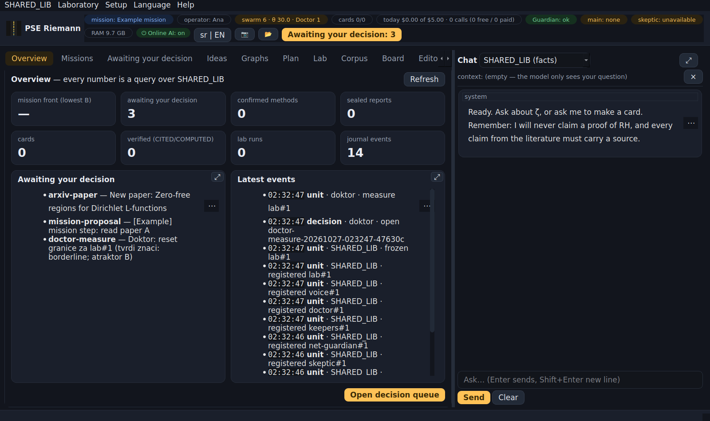
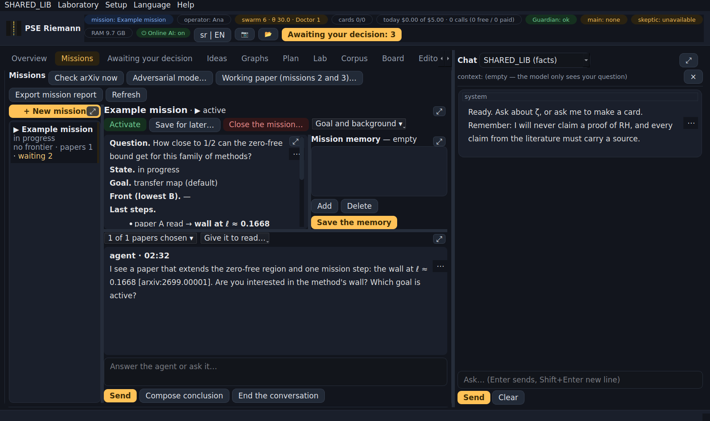
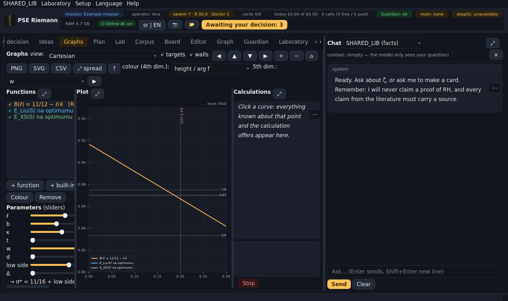
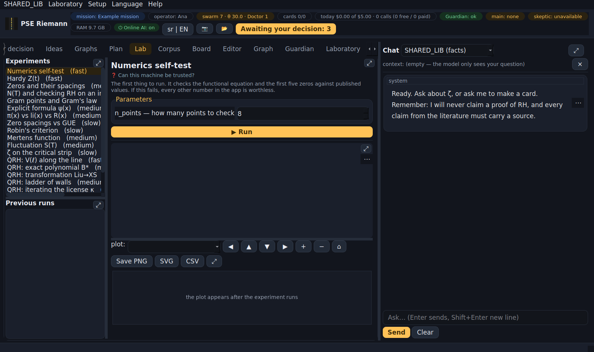
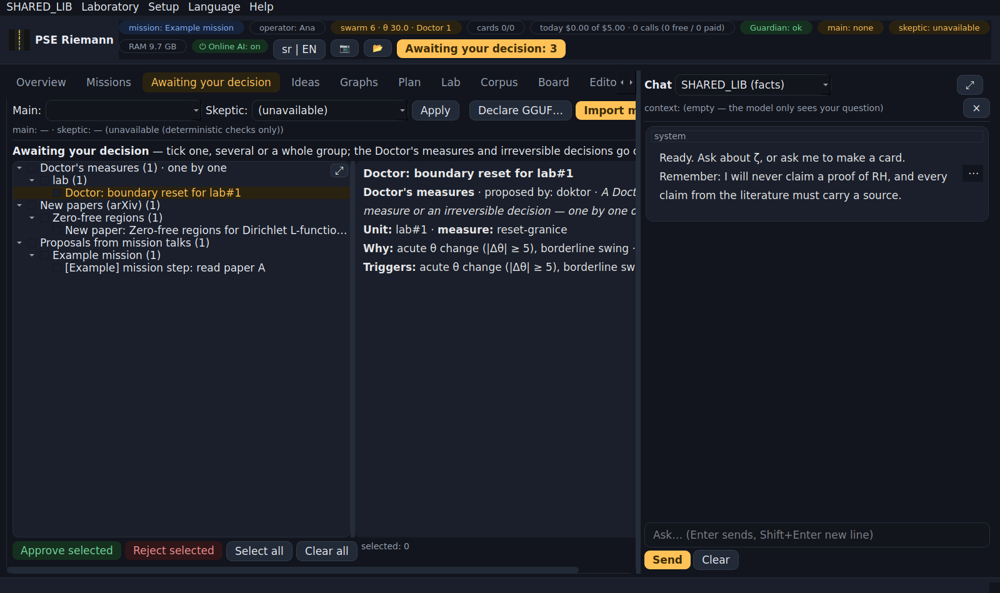
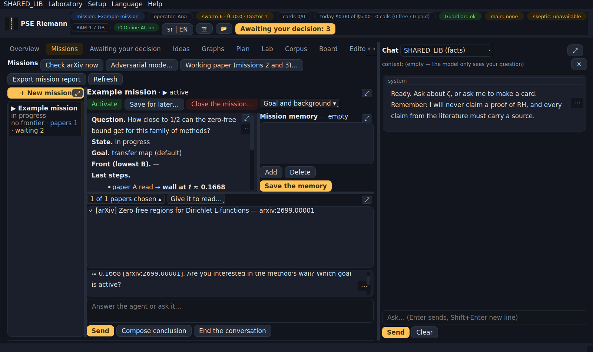
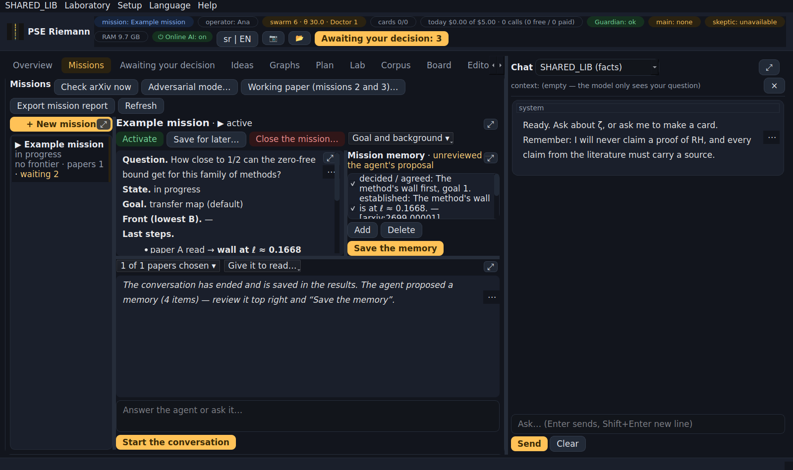
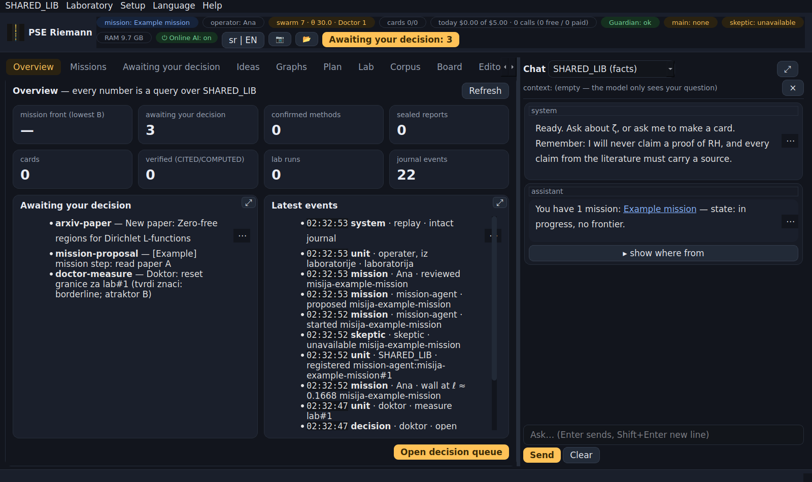
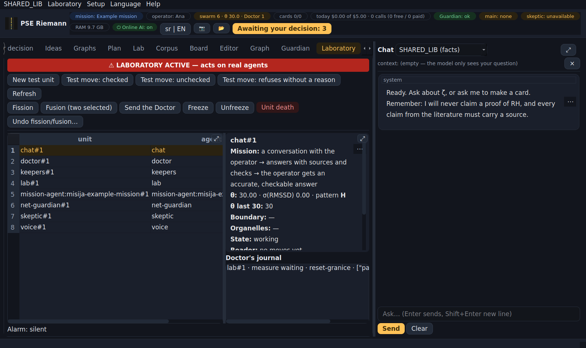
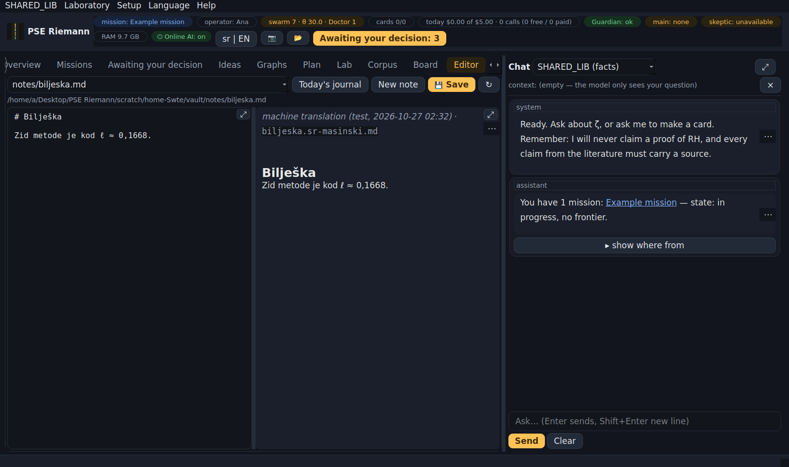

# PSE Riemann 0.3.0 — guide

The complete guide to the whole application. Ordered by importance: first what you need on day one, details at the end.
The Serbian version with the same content: `VODIC-SR.md`. In the app: **Help → Guide**; any text in the app can be translated with a right click or the **⋯** button ("Translate to Serbian / English").

---

## 1. What PSE Riemann is

A desktop application for studying the Riemann zeta function and similar research questions, built so that:

- **it claims nothing without a source or a computation** — every claim is either computed (lab), cited (a source that can be found), or clearly marked as a guess;
- **no AI decides for you** — everything that changes your data waits for your decision;
- **it works without the internet** (local model), and protects your keys and data on foreign networks.

Several "agents" work inside (chat, skeptic, paper reader, guardians…). In version 0.3.0 **every agent is a PSE unit** with its own health measure θ, and above them stands the **Doctor**. §8 explains what this means for you.

---

## 2. Installing and the first start

**Installing** (Ubuntu / Mint, 64-bit):

```bash
sudo apt install ./pse-riemann_0.3.0_amd64.deb
```

The package carries all its own Python libraries (PySide6, mpmath, numpy, matplotlib, sympy, scipy, llama-cpp) and does not touch the system Python. Removing: `sudo apt remove pse-riemann` — your data stays.

**Starting:** from the menu (PSE Riemann) or `pse-riemann` in a terminal. Health check: `pse-riemann --selftest` must say **SVE PROLAZI** (all pass).

**First start — setup in 5 steps:**

1. **Operator name** — just a name, no password. It is bound to every decision you make.
2. **Main AI** — Claude, OpenAI, Gemini, Mistral, Groq, DeepSeek, xAI, OpenRouter, Together, Fireworks, your own address, a local GGUF, or "no AI". "Load real models" asks the server what it actually offers; "Test" makes one small call.
3. **Skeptic** — always a **different** model (or "no skeptic").
4. **Declarations** — for a local model the file hash, for your own address a confirmation.
5. **Guardian at login** and email (optional).

You change all of this later in **Settings** (menu bar or the last tab "⚙ Settings").

**⚠ Before travelling:** start the app for the first time **on a network you trust** (at home) and run *Guardian → Network test*. The app remembers the servers' keys (TLS pins) at first contact; if your first contact is on hotel WiFi, you will remember the interceptor.

---

## 3. The screen

- **Top bar (pills):** active mission · operator · **swarm** (number of PSE units, mean θ, frozen, Doctor's measures) · cards · today's spending · Guardian · main AI · skeptic · RAM · **Online AI** switch · **SR | EN** · 📷 screenshot · 📂 results · the **Awaiting your decision: N** button.
- **Menu bar:** **SHARED_LIB** (Vote weights, Awaiting your decision, Swarm state) · **Laboratory** · **Settings** · **Language** (SR/EN) · **Help** (Guide).
- **Left — tabs:** Overview, Missions, Awaiting your decision, Ideas, Graphs, Plan, Lab, Corpus, Board, Editor, Graph, Guardian, Laboratory, ⚙ Settings.
- **Right — Chat** (about 30 % of the width).



- Every panel has **⤢** (spread over the tab; again = back). The borders between panels can be dragged. Window and panel sizes are remembered.

---

## 4. The tabs, one by one

**Overview** — every number is a query over the library: the mission frontier, the decision queue, methods, seals, cards, lab, journal; latest events.

**Missions** — the missions' workspace:
- **on the left** the missions as cards (title, short state, frontier, number of papers, how many items await you) and *+ New mission*; ▶ = active, ⏸ = saved for later;
- **a click on a mission** opens its workspace and starts the mission agent at once (§6);
- **upper right:** the chosen mission's details (question, state, goal, frontier, last steps) and your **"Where you left off"** note, and beside them the **mission memory** (§6); buttons *Activate*, *Save for later…* (a "where you left off" note + an automatic snapshot), *Close the mission…* (the mission agent dies, everything in it goes to SHARED_LIB) and *Goal and background ▾* (only you change the goal; "while it waits": fully frozen or quietly collecting);
- **lower right:** the paper strip and the conversation with the agent; drag the border between the upper and lower part with the mouse;
- **at the top of the tab** is what holds for all missions: *Check arXiv now*, *Adversarial mode…*, *Working paper…*, *Export mission report*.



**Awaiting your decision** — the one place where everything waits for you (§5).

**Ideas** — INSPIRATIONS (ideas, never claims) from new literature around your missions; at most 3 a week; the skeptic attacks them before you see them. For each: keep · drop · open question · snooze.

**Graphs** — three panels: Functions · Graph · Computations. Click a point = "everything about the point" and offers to compute; expensive computations run in the background with "Stop". Views: Cartesian, parametric, polar, vector field, complex (phase portrait), cross-section, 3D, small multiples, parallel coordinates. Detailed guide: the **?** button in the tab.



**Plan** — the morning briefing (yesterday, the state of the vault, the PSE swarm, what needs attention, open questions, the plan) and the weekly report.

**Lab** — reproducible numerical experiments (19). Every run makes a `COMPUTED` card with the parameters, numbers, plot and the **sha256 of the script**. Run *Numerics self-test* first.



**Corpus** — from the internet to knowledge: harvest → triage → promotion through the gate; *📖 Read paper* (arXiv) and *⚔ Skeptic* on a card.

**Board** — you draw; strokes are always kept as SVG + PNG; *Transcribe* gives LaTeX as a proposal (needs a vision model).

**Editor** — the vault's markdown files (notes, journal, cards, plan) with a preview.

**Graph** — the knowledge graph: topics, cards, methods, missions; a click opens the card.

**Guardian** — the state of the network and the computer (firewall, listening services, CA certificates, DNS, pins), network test, benchmark.

**Laboratory** — PSE units up close (§8). **Acts on real agents.**

**⚙ Settings** — opens the setup and brings you back to the tab you were on.

---

## 5. "Awaiting your decision"

Everything that changes your data or needs your word comes here: new papers (extract a method?), proposals from mission talks, mission goal, skeptic's objections, adversarial findings, methods that passed the door, the working paper, declarations, host quarantine, "→ ∞" pause, **the Doctor's measures**, vote weights.



- Items are in a **tree**: kind → mission or paper topic → item. Clicking an item shows everything about it, with the **full abstract**.
- Checkboxes on items and groups; **Approve selected** / **Reject selected** — one, several or all. Before a group decision you always get "Approve N items?".
- **The Doctor's measures and irreversible decisions go one by one only.** "Select all" skips them.
- Every decision is recorded with your name and takes effect exactly once.

---

## 6. Talking about a mission (the mission agent) and the mission memory

**A click on a mission** in the Missions tab starts the mission agent: it reads the mission's state, **the memory of the last session**, your "where you left off" note and the papers, writes the first message (what it sees, where you stopped, at most 3 questions) and waits for you. The first model call costs.

**Which papers it reads:** the first time all of the mission's papers (abstracts). After that the papers you chose last time plus the papers that arrived since — those are marked **🆕 new** in the strip. The strip *"N of M papers chosen ▾"* folds open; tick or untick, and the agent reads the new choice from its next move.

**Give it to read…** — hand the agent more reading: a paper from the list, **the full text of an arXiv paper** (arXiv only, only when you ask), a card, a report or your own note.

In the conversation:
1. you write and *Send*; the agent answers with a source (a paper's [ref] or a mission step), at most 3 questions per reply;
2. **the skeptic attacks every reply that contains a claim** (a number, "holds", "follows");
3. *Compose conclusion* — the proposals (mission steps, open questions, ideas, a goal, a method for the door) each go **separately** into "Awaiting your decision". Nothing is written on its own.



**The mission memory.** The next session does not get the old conversation, **only what matters**: what was decided or agreed, what was established (always with a source), open questions and the agreed next step.
- The agent **proposes** the memory at the end of a session: when you click *End the conversation*, when you switch to another mission, or when you close the app.
- The proposal is saved at once, marked **"unreviewed"**, so it stands even if you never decide.
- You review it upper right: tick what stays, double-click to correct the text, *Add* or *Delete* an item, then **Save the memory**.



The whole conversation is still saved in the results (`razgovori-o-misiji/`, label NAŠE-NERECENZIRANO / OURS-UNREVIEWED), but the agent no longer reads it. Every mission has its own agent (a PSE unit with an open lifespan); closing the mission ends it. **Without AI the mission agent does not work** and says so in the conversation itself.

---

## 7. Chat and the SHARED_LIB voice

- **"SHARED_LIB (facts)"** (default): your question → **one read-only SELECT** over the library → an answer in sentences, like a colleague at work, with `[id]` citations. Below it is **▸ show where from** — the exact SQL and the rows. When the data is not there: "That is not in the library (UNKNOWN)", never a guess. You can also type SQL directly. Without a model it works for known questions (missions, methods, cards, lab, awaiting) with template sentences.
  - **Mission names are links**: a click opens that mission's workspace.
  - To a **question that asks for judgment** ("what is the next step", "what should I do") the base gives no answer and says so, with a link **"Talk about the mission: X"** — that is the mission agent's job.
  - If the model writes invalid SQL, the voice tries once more with the error; if that fails too, you get a plain sentence, and the technical detail is under "show where from".



- The other modes are a conversation with the main AI. The model **does not write into the vault** — it proposes a card, and you see the gate's verdict before clicking.
- **The context is explicit:** what is in the context bar is what the model sees.
- Every reply goes through the "three harms" check (§8); if the Doctor finds something bad, a message tells you the measure is in "Awaiting your decision".

---

## 8. PSE units, the Doctor and the Laboratory

**Every agent is a PSE unit:** chat, voice, skeptic, extractor, reader, curator, ideas, board, translator, network guardian, SSH guardian, seal keepers, adversarial mode, arXiv watcher, paper builder, mission agent — and the Doctor itself. A unit has:

- a **mission** (state → action → outcome) and a **lifespan** (number of moves), given by SHARED_LIB and impossible for the unit to change;
- a **boundary** (whom it is in contact with) and **organelles** (what it has permanently absorbed);
- **θ** — how much it is turned toward others versus itself. **Healthy is about 30 (± 5).** θ is measured on every move: for agents without AI from the work (was the action checked), for AI agents from the words (rules + a reader, a different model).

**When something looks suspicious** (an acute jump of θ, an attempted irreversible action, a harmful output, contact outside the allowed destinations, an attempt to export protected data…), the unit is **frozen at once** and the **Doctor** comes:

- nothing bad → a journal record, the unit carries on;
- something bad → **a measure for your approval** (boundary reset → healing → replacement by a new generation → death). While the measure waits the unit works, but **with no irreversible actions**; at a new suspicion it stays frozen until you decide.

When a unit ends its life (for any reason), **everything in it goes to SHARED_LIB**; its successor inherits what it had absorbed at 70 % until confirmed. Fission (splitting) and fusion (merging) are chosen by SHARED_LIB alone — they are reversible; only you can undo them.

**The "swarm" pill** shows the number of units and the mean θ; **SHARED_LIB → Swarm state** gives a table.

**Laboratory** (tab or menu). ⚠ **It acts on real agents** — so the first time you open it in a session an alarm sounds (3 s), and a red banner stays while the tab is open. There you see every unit (θ, pattern, state, lifespan, generation), the Doctor's journal, and you can: make a test unit, make a test move, fission, fusion (two selected), send the Doctor, freeze / unfreeze, end a unit, ask to undo a fission/fusion. Every action is recorded as "operator, from the laboratory".



**Vote weights** (SHARED_LIB → Vote weights): how much the reader counts against the rules. SHARED_LIB proposes once a week (only with at least 200 decided cases; one weight moves at most ±10 %), you approve. *Propose now* if you need it earlier.

---

## 9. AI: the main model, the skeptic, cost, the local model

- **The main AI** does every role; **the skeptic is always a different model** and only attacks (objection · reason · where · severity), with no right to write. Without a second model the skeptic is "unavailable" and the deterministic checks remain.
- **Online AI switch** (top bar or **Ctrl+K**): closes the road to cloud models at once and cuts streams in progress. Only the operator turns it on. It switches itself off if the number, size or cost of calls goes "→ ∞".
- **Daily limit** (default $5) applies to paid providers; the pill shows what was **spent today**. The local model costs nothing.
- **Local GGUF** (e.g. DeepSeek-R1-0528-Qwen3-8B Q5_K_M): put the `.gguf` in the models folder or pick it anywhere; it is admitted by sha256 (declaration). It runs under limiters (RAM, threads, context, thinking budget, deadline, loop break) and **only toward this computer**. On a weaker computer it is slow.
- **"→ ∞"**: when latency, memory or cost grow without bound, calls are paused, the model is released, and you approve resuming.

---

## 10. Translation (Serbian / English)

- **The interface** is all Serbian or all English — **Language** in the menu or **SR | EN** in the bar (needs a restart).
- **Content** (cards, papers, missions, conversations, reports, your notes) is **not translated in advance** and stays as it is (Serbian–English mixtures too).
- In every text viewer: **right click** or **⋯** in the corner → **Translate to Serbian**, **Translate to English**, **Show original**. In the Editor the same in the right-click menu; the translation appears in the preview beside the original.



- The **translator** (a PSE unit) translates **only when you start it**, with the main AI. The original never changes; the translation is labelled "machine translation (model, date)".
- A translation is remembered (the same text is never paid twice), and for a file it is saved **beside the original** as `name.en-masinski.md` / `name.sr-masinski.md` (the index does not count it as a card). When the original changes, the old translation gets a date in its name.
- A long text (e.g. a whole paper): you first see an estimate (characters, tokens, cost or time) and decide.
- Licensed papers from `papers-local` are translated only by the local model.

---

## 11. Security

- **All outgoing traffic** goes through one gate: https only, an allowlist (everything else forbidden), host quarantine, rate limits, **keys only to model APIs**, TLS **pinning**, manual redirects, size limits.
- **Disclosure budget:** before every call to a cloud model, what leaves is measured — keys and private data (IP, MAC, paths, computer name) never leave; text from licensed papers at most 2,000 characters a day per destination.
- **The network guardian** watches every request; a suspicious host goes into quarantine, and you release it (a queue item).
- **The SSH guardian** (a separate process) watches logins to the computer; it applies reversible measures (block an IP for 24 h, end a session) on its own if it has a narrow sudo right (guide `SUDOERS-EN.md`), and proposes permanent measures to you with the exact command.
- **Seal keepers:** every final report is sealed (sha256); a change is detected, the original restored, and the changed version kept in `forensic/`.
- **TLS pins are learned on first contact:** the first time the app talks to a server, it remembers its public keys and afterwards refuses any other. The one weakness: if the first contact is intercepted, it remembers the interceptor — so make the first contact from a network you trust (Corpus → Collect, Guardian → Network test). The app says this itself on first start. If something goes wrong: **Setup → Re-scan TLS pins…** (or the button in the Guardian tab), only from a network you trust; a server that is not reachable then keeps its old keys.
- **The journal** is append-only with a hash chain; decisions can be re-derived and checked (replay).

---

## 12. The gate — why this is not a wiki

Everything that enters the vault goes through one function.

| status | means | condition |
|---|---|---|
| `COMPUTED` | we computed it | lab run + sha256 of the script |
| `CITED` | someone else did, and we can find where | at least one resolvable source |
| `FOLKLORE` | a claim without a source | passes, but marked |
| `SPECULATION` | an idea | only in `speculation/` |
| `SUSPECT` | the skeptic hit it | the objection stays in the card |
| `REFUTED` | shown false | never deleted |

Sources: `arxiv:…`, `doi:…`, `lmfdb:…`, `oeis:…`, `openalex:…`, `mathoverflow:…`, `wikipedia:…`, `book:…`, `url:…`. Tiers: REFEREED · LEAN · PREPRINT · AI-UNREVIEWED · OURS-UNREVIEWED; a preprint cannot support an established claim. **A claim to have proved RH (or other famous open problems) is refused**, whoever wrote it.

---

## 13. Where your files are

- **Results (vault):** the **"PSE Riemann rezultati"** folder on the Desktop (📂 in the top bar opens it): `knowledge/`, `speculation/`, `sources/`, `notes/`, `daily/`, `lab/`, `reports/`, `razgovori-o-misiji/`, `.state/` (journal, SHARED_LIB database, pins).
- **Keys and settings:** `~/.config/pse-riemann/` (keys in `secrets.json`, permissions 0600) — never in the vault.
- **Local models:** the `models` folder in "PSE Riemann rezultati" (beside the vault).
- **Screenshots:** `~/Pictures/PSE-Riemann/` (F12, Shift+F12, 📷).
- **Backup:** copy the "PSE Riemann rezultati" folder and `~/.config/pse-riemann/`. The vault is plain markdown — it opens without the app too.

---

## 14. Shortcuts

`Ctrl+Shift+P` command palette · `Ctrl+K` online AI switch · `Ctrl+1/2/3` Overview / Missions / Awaiting your decision · `Ctrl +/−/0` text size · `Ctrl+S` save in the Editor · `Enter` sends in the chat, `Shift+Enter` new line · `F12` window screenshot · `Shift+F12` screenshot of the active tab · `Esc` brings back a spread panel.

---

## 15. If something breaks

| symptom | what to do |
|---|---|
| numbers look odd | `pse-riemann --selftest`; if it fails, trust nothing else |
| "no model chosen" | Settings → main AI |
| a unit is "❄ frozen" | "Awaiting your decision" → the Doctor's measure; decide |
| many Doctor's measures waiting | look at the Laboratory (pattern, triggers); report the live-test result |
| "online AI is OFF" | the Online AI button / Ctrl+K (only the operator turns it on) |
| "→ ∞" pause | "Awaiting your decision" → approve resuming once you have looked |
| "certificate does NOT match" | stop working on that network; delete a pin only from a network you trust |
| host in quarantine | queue item: Approve = release (knowingly) |
| the API host returned HTML | captive portal — log in to the network; the key was NOT sent |
| the local model is slow | normal on a weaker computer; try a smaller model |
| window too big / too small | `Ctrl +/−`, or palette → "View — interface size" |

---

## 16. What this is NOT

- Not a theorem prover; it does not check proofs formally.
- Not protection for the whole computer — it protects the app's surface and **tells you** how the computer looks to the network.
- It does not know whether the Riemann hypothesis is true and will not pretend to. Everything the app derives itself is labelled OURS-UNREVIEWED.
