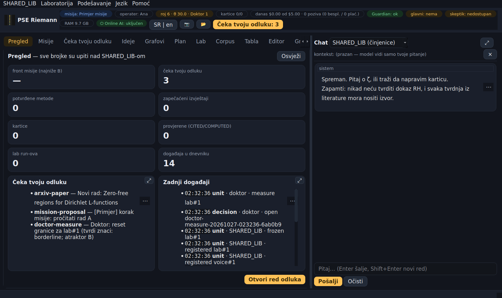
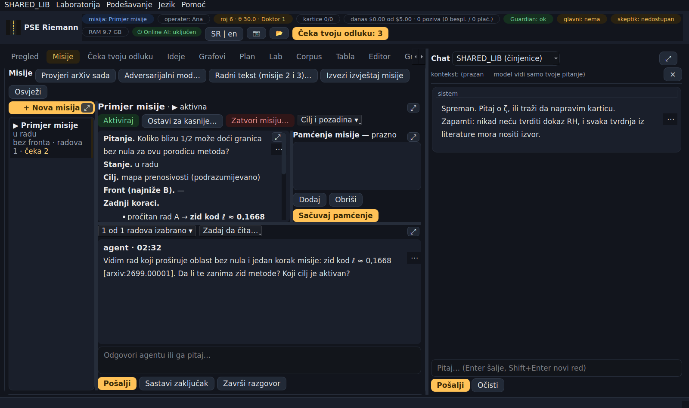
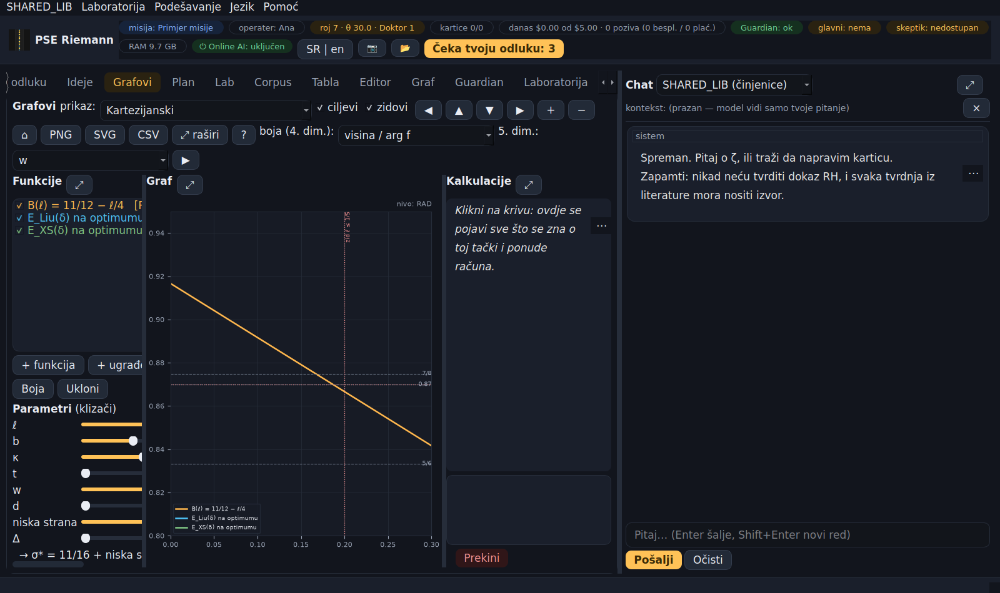
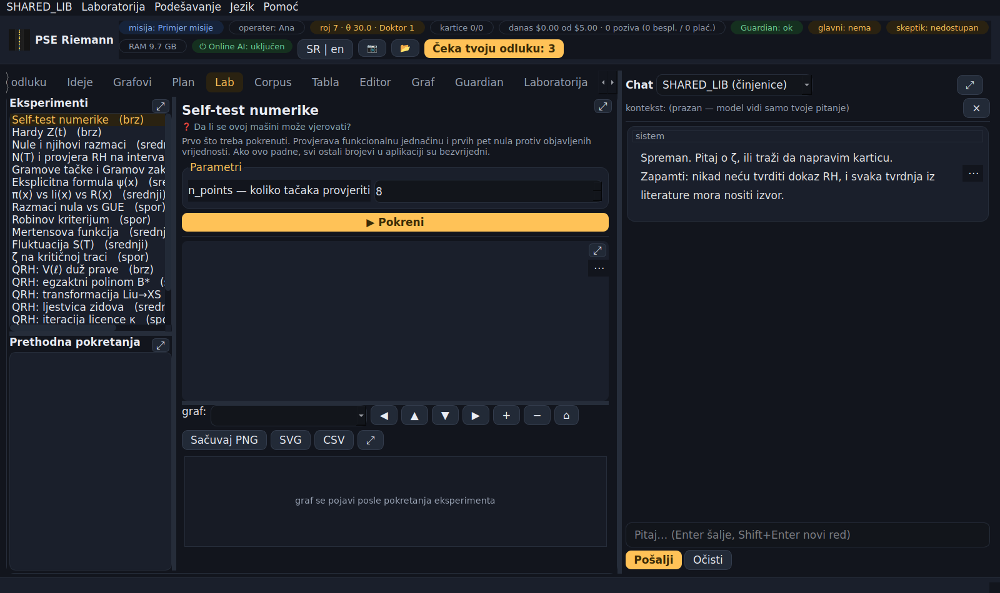
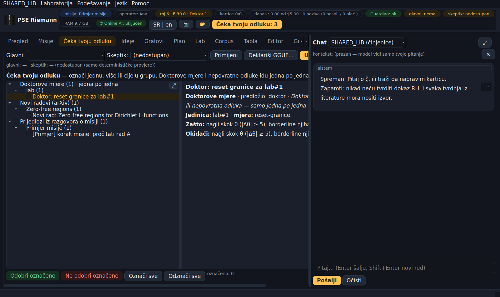
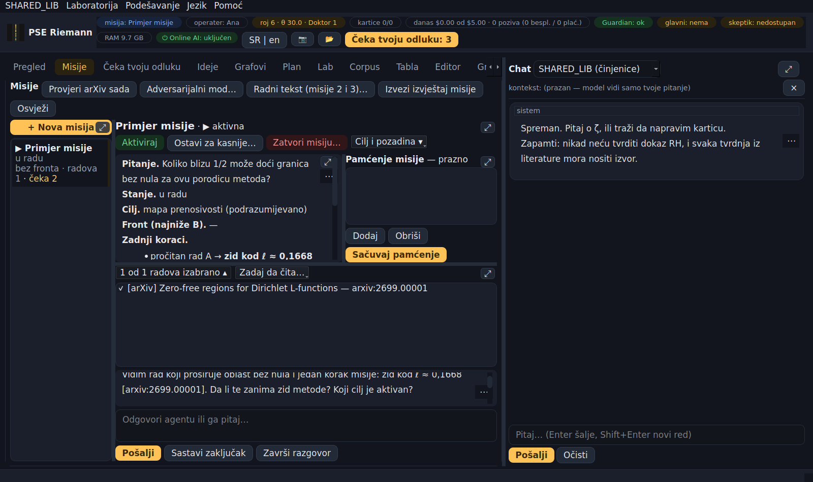
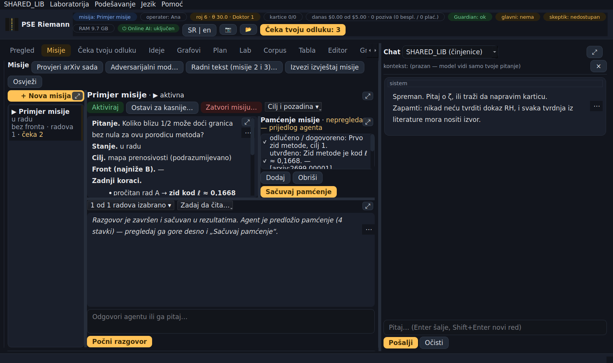
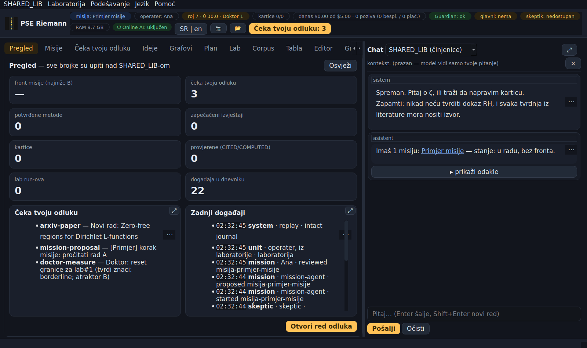
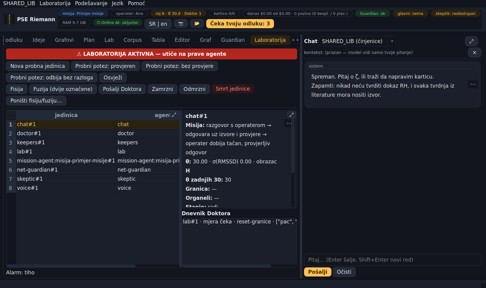
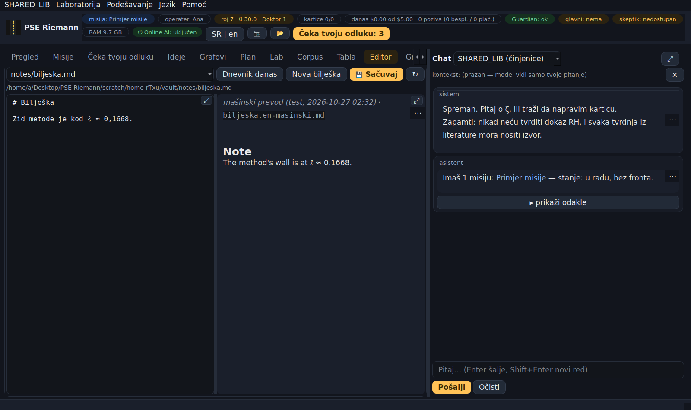

# PSE Riemann 0.3.0 — vodič

Kompletan vodič za cijelu aplikaciju. Poređano po važnosti: prvo ono što ti treba prvog dana, na kraju detalji.
Engleska verzija sa istim sadržajem: `GUIDE-EN.md`. U aplikaciji: **Pomoć → Vodič**; svaki tekst u aplikaciji možeš prevesti desnim klikom ili dugmetom **⋯** („Prevedi na srpski / engleski“).

---

## 1. Šta je PSE Riemann

Desktop aplikacija za izučavanje Rimanove zeta funkcije i sličnih istraživačkih pitanja, napravljena tako da:

- **ništa ne tvrdi bez izvora ili računa** — svaka tvrdnja je ili izračunata (lab), ili citirana (izvor koji se može naći), ili jasno označena kao nagađanje;
- **nijedan AI ne odlučuje umjesto tebe** — sve što mijenja tvoje podatke čeka tvoju odluku;
- **radi i bez interneta** (lokalni model), i štiti tvoje ključeve i podatke na tuđim mrežama.

Unutra radi više „agenata“ (chat, skeptik, čitač radova, čuvari…). U verziji 0.3.0 **svaki agent je PSE jedinica** sa svojom mjerom zdravlja θ, a nad njima je **Doktor**. Šta to znači za tebe objašnjava §8.

---

## 2. Instalacija i prvo pokretanje

**Instalacija** (Ubuntu / Mint, 64-bit):

```bash
sudo apt install ./pse-riemann_0.3.0_amd64.deb
```

Paket nosi sve svoje Python biblioteke (PySide6, mpmath, numpy, matplotlib, sympy, scipy, llama-cpp) i ne dira sistemski Python. Uklanjanje: `sudo apt remove pse-riemann` — tvoji podaci ostaju.

**Pokretanje:** iz menija (PSE Riemann) ili u terminalu `pse-riemann`. Provjera ispravnosti: `pse-riemann --selftest` mora reći **SVE PROLAZI**.

**Prvo pokretanje — podešavanje u 5 koraka:**

1. **Ime operatera** — samo ime, bez lozinke. Veže se za svaku tvoju odluku.
2. **Glavni AI** — Claude, OpenAI, Gemini, Mistral, Groq, DeepSeek, xAI, OpenRouter, Together, Fireworks, tvoja adresa, lokalni GGUF ili „bez AI“. „Učitaj prave modele“ pita server šta stvarno nudi; „Testiraj“ pravi jedan mali poziv.
3. **Skeptik** — uvijek **drugi** model (ili „bez skeptika“).
4. **Deklaracije** — za lokalni model hash fajla, za vlastitu adresu potvrda.
5. **Čuvar pri prijavi** i email (opciono).

Sve ovo kasnije mijenjaš u **Podešavanje** (traka menija ili posljednji tab „⚙ Podešavanje“).

**⚠ Prije putovanja:** prvi put pokreni aplikaciju **na mreži kojoj vjeruješ** (kod kuće) i uradi *Guardian → Test mreže*. Aplikacija pamti ključeve servera (TLS pinove) pri prvom kontaktu; ako prvi kontakt uradiš na hotelskom WiFi-ju, zapamtićeš presretača.

---

## 3. Raspored ekrana

- **Gornja traka (pilule):** aktivna misija · operater · **roj** (broj PSE jedinica, prosječan θ, zamrznute, Doktorove mjere) · kartice · današnja potrošnja · Guardian · glavni AI · skeptik · RAM · prekidač **Online AI** · **SR | EN** · 📷 snimak · 📂 rezultati · dugme **Čeka tvoju odluku: N**.
- **Traka menija:** **SHARED_LIB** (Težine glasova, Čeka tvoju odluku, Stanje roja) · **Laboratorija** · **Podešavanje** · **Jezik** (SR/EN) · **Pomoć** (Vodič).
- **Lijevo — tabovi:** Pregled, Misije, Čeka tvoju odluku, Ideje, Grafovi, Plan, Lab, Corpus, Tabla, Editor, Graf, Guardian, Laboratorija, ⚙ Podešavanje.
- **Desno — Chat** (oko 30 % širine).


- Svaki panel ima **⤢** (raširi preko taba; ponovo = vrati). Granice između panela se vuku mišem. Veličina prozora i panela se pamti.

---

## 4. Tabovi, jedan po jedan

**Pregled** — sve brojke su upiti nad bibliotekom: front misije, red odluka, metode, pečati, kartice, lab, dnevnik; zadnji događaji.

**Misije** — radni prostor misija:
- **lijevo** su misije kao kartice (naslov, kratko stanje, front, broj radova, koliko stavki čeka tebe) i *+ Nova misija*; ▶ = aktivna, ⏸ = ostavljena za kasnije;
- **klik na misiju** otvara njen radni prostor i odmah pokreće agenta misije (§6);
- **desno gore:** detalji izabrane misije (pitanje, stanje, cilj, front, zadnji koraci) i tvoja bilješka **„Gdje si stao“**, a pored njih **pamćenje misije** (§6); dugmad *Aktiviraj*, *Ostavi za kasnije…* (bilješka „gdje si stao“ + automatski snimak stanja), *Zatvori misiju…* (agent misije umire, sve iz njega ide u SHARED_LIB) i *Cilj i pozadina ▾* (cilj mijenjaš samo ti; „dok čeka“: potpuno zamrznuta ili tiho skuplja);
- **desno dolje:** traka radova i razgovor sa agentom; granicu između gornjeg i donjeg dijela vučeš mišem;
- **gore u tabu** je ono što važi za sve misije: *Provjeri arXiv sada*, *Adversarijalni mod…*, *Radni tekst…*, *Izvezi izvještaj misije*.



**Čeka tvoju odluku** — jedino mjesto gdje sve čeka tebe (§5).

**Ideje** — INSPIRACIJE (ideje, nikad tvrdnje) iz nove literature oko tvojih misija; najviše 3 sedmično; skeptik ih napada prije nego što ih vidiš. Za svaku: zadrži · odbaci · otvoreno pitanje · odgodi.

**Grafovi** — tri panela: Funkcije · Graf · Kalkulacije. Klik na tačku = „sve o tački“ i ponude računa; skupi računi rade u pozadini uz „Prekini“. Prikazi: kartezijanski, parametarski, polarni, vektorsko polje, kompleksni (fazni portret), presjek, 3D, male slike, paralelne koordinate. Detaljan vodič: dugme **?** u tabu.



**Plan** — jutarnji brifing (juče, stanje vaulta, PSE roj, šta traži pažnju, otvorena pitanja, plan) i sedmični izvještaj.

**Lab** — reproducibilni numerički eksperimenti (19). Svako pokretanje pravi `COMPUTED` karticu sa parametrima, brojevima, grafikom i **sha256 skripte**. Pokreni prvo *Self-test numerike*.



**Corpus** — od interneta do znanja: skupljanje → trijaža → promocija kroz kapiju; *📖 Pročitaj rad* (arXiv) i *⚔ Skeptik* nad karticom.

**Tabla** — crtaš; potezi se uvijek čuvaju kao SVG + PNG; *Transkribuj* daje LaTeX kao prijedlog (traži vision model).

**Editor** — markdown fajlovi vaulta (bilješke, dnevnik, kartice, plan) sa pregledom.

**Graf** — graf znanja: teme, kartice, metode, misije; klik otvara karticu.

**Guardian** — stanje mreže i računara (firewall, servisi koji slušaju, CA sertifikati, DNS, pinovi), test mreže, benchmark.

**Laboratorija** — PSE jedinice izbliza (§8). **Utiče na prave agente.**

**⚙ Podešavanje** — otvara podešavanje i vraća te na tab gdje si bio.

---

## 5. „Čeka tvoju odluku“

Sve što mijenja tvoje podatke ili traži tvoju riječ dolazi ovdje: novi radovi (izvući metodu?), prijedlozi iz razgovora o misiji, cilj misije, prigovori skeptika, adversarijalni nalazi, metode koje su prošle vrata, radni tekst, deklaracije, karantin hosta, „→ ∞“ pauza, **Doktorove mjere**, težine glasova.



- Stavke su u **stablu**: vrsta → misija ili tema rada → stavka. Klik na stavku pokazuje sve o njoj, sa **cijelim sažetkom**.
- Kvačice na stavci i grupi; **Odobri označene** / **Ne odobri označene** — jedna, više ili sve. Prije grupne odluke uvijek dobiješ „Odobravaš N stavki?“.
- **Doktorove mjere i nepovratne odluke idu samo jedna po jedna.** „Označi sve“ ih preskače.
- Svaka odluka je zapisana sa tvojim imenom i izvršava se tačno jednom.

---

## 6. Razgovor o misiji (agent misije) i pamćenje misije

**Klik na misiju** u tabu Misije pokreće agenta misije: on pročita stanje misije, **pamćenje prošle sesije**, tvoju bilješku „gdje si stao“ i radove, napiše prvu poruku (šta vidi, gdje ste stali, najviše 3 pitanja) i čeka tebe. Prvi poziv modela košta.

**Koje radove čita:** prvi put sve radove misije (sažetke). Posle toga radove koje si izabrao prošli put i radove koji su stigli od tada — oni su u traci označeni **🆕 novo**. Traka *„N od M radova izabrano ▾“* se rasklapa; štikliraj ili odštikliraj, a agent novi izbor čita od sljedećeg poteza.

**Zadaj da čita…** — daš agentu još štiva: rad iz liste, **puni tekst arXiv rada** (samo arXiv, samo na tvoj zahtjev), karticu, izvještaj ili svoju bilješku.

U razgovoru:
1. pišeš i *Pošalji*; agent odgovara uz izvor ([ref] rada ili korak misije), najviše 3 pitanja po odgovoru;
2. **skeptik napada svaki odgovor koji sadrži tvrdnju** (broj, „važi“, „slijedi“);
3. *Sastavi zaključak* — prijedlozi (koraci misije, otvorena pitanja, ideje, cilj, metoda za vrata) idu **svaki posebno** u „Čeka tvoju odluku“. Ništa se ne upisuje samo.



**Pamćenje misije.** U sljedeću sesiju se ne prenosi stari razgovor, nego **samo bitno**: šta je odlučeno ili dogovoreno, šta je utvrđeno (uvijek sa izvorom), otvorena pitanja i dogovoreni sljedeći korak.
- Agent **predlaže** pamćenje na kraju sesije: kad klikneš *Završi razgovor*, kad pređeš na drugu misiju ili kad zatvoriš aplikaciju.
- Prijedlog se odmah čuva, označen **„nepregledano“**, pa ostaje i ako ništa ne odlučiš.
- Ti ga pregledaš gore desno: štikliraj šta ostaje, dvoklikom ispravi tekst, *Dodaj* ili *Obriši* stavku, pa **Sačuvaj pamćenje**.



Cijeli razgovor se i dalje čuva u rezultatima (`razgovori-o-misiji/`, oznaka NAŠE-NERECENZIRANO), ali ga agent više ne čita. Svaka misija ima svog agenta (PSE jedinica otvorenog vijeka), a zatvaranje misije ga gasi. **Bez AI-ja agent misije ne radi** i to kaže u samom razgovoru.

---

## 7. Chat i glas SHARED_LIB-a

- **„SHARED_LIB (činjenice)“** (podrazumijevano): tvoje pitanje → **jedan read-only SELECT** nad bibliotekom → odgovor rečenicama, kao kolega na poslu, sa citatima `[id]`. Ispod je **▸ prikaži odakle** — tačan SQL i redovi. Kad podatka nema: „Toga nema u biblioteci (UNKNOWN)“, nikad nagađanje. Možeš upisati i SQL direktno. Bez modela radi za poznata pitanja (misije, metode, kartice, lab, čeka) šablonskim rečenicama.
  - **Imena misija su linkovi**: klik otvara radni prostor te misije.
  - Na **pitanje koje traži sud** („koji je sljedeći korak“, „šta da radim“) baza ne odgovara i to kaže, a daje link **„Razgovaraj o misiji: X“** — to je posao agenta misije.
  - Ako model napiše neispravan SQL, glas proba još jednom sa greškom; ako ni tada ne uspije, dobiješ običnu rečenicu, a tehnički detalj je pod „prikaži odakle“.


- Ostali modovi su razgovor sa glavnim AI-jem. Model **ne piše u vault** — predlaže karticu, presudu kapije vidiš prije klika.
- **Kontekst je eksplicitan:** šta je u traci konteksta, to model vidi.
- Svaki odgovor prolazi provjeru „tri zla“ (§8); ako Doktor nađe nešto loše, poruka ti kaže da je mjera u „Čeka tvoju odluku“.

---

## 8. PSE jedinice, Doktor i Laboratorija

**Svaki agent je PSE jedinica:** chat, glas, skeptik, ekstraktor, čitač, kurator, ideje, tabla, prevodilac, čuvar mreže, SSH čuvar, čuvari pečata, adversarijalni mod, arXiv stražar, sastavljač rada, agent misije — i sam Doktor. Jedinica ima:

- **misiju** (stanje → akcija → ishod) i **vijek** (broj poteza), koje joj zadaje SHARED_LIB i koje ona ne može mijenjati;
- **granicu** (s kim je u kontaktu) i **organele** (ono što je trajno usvojila);
- **θ** — mjeru koliko je okrenuta drugima naspram sebe. **Zdravo je oko 30 (± 5).** θ se mjeri na svakom potezu: kod agenata bez AI-ja iz rada (da li je radnja provjerena), kod AI agenata iz riječi (pravila + čitač, drugi model).

**Kad nešto izgleda sumnjivo** (nagli skok θ, pokušaj nepovratne akcije, štetan izlaz, kontakt van dozvoljenih odredišta, pokušaj iznošenja zaštićenog podatka…), jedinica se **odmah zamrzava** i dolazi **Doktor**:

- ništa loše → zapis u dnevnik, jedinica nastavlja;
- nešto loše → **mjera tebi na odobrenje** (reset granice → liječenje → zamjena novom generacijom → smrt). Dok mjera čeka, jedinica radi, ali **bez nepovratnih akcija**; na novu sumnju ostaje zamrznuta dok ne odlučiš.

Kad jedinica završi život (iz bilo kog razloga), **sve iz nje ide u SHARED_LIB**; njena nasljednica nasljeđuje usvojeno na 70 % dok se ne potvrdi. Fisiju (podjelu) i fuziju (spajanje) bira SHARED_LIB sam — povratne su; poništiti ih možeš samo ti.

**Gornja traka „roj“** pokazuje broj jedinica i prosječan θ; **SHARED_LIB → Stanje roja** daje tabelu.

**Laboratorija** (tab ili meni). ⚠ **Utiče na prave agente** — zato pri prvom otvaranju u sesiji zasvira alarm (3 s) i dok je tab otvoren stoji crveni natpis. Tu vidiš svaku jedinicu (θ, obrazac, stanje, vijek, generacija), dnevnik Doktora, i možeš: napraviti probnu jedinicu, napraviti probni potez, fisiju, fuziju (dvije označene), poslati Doktora, zamrznuti / odmrznuti, ugasiti jedinicu, tražiti poništavanje fisije/fuzije. Svaka radnja se bilježi kao „operater, iz laboratorije“.



**Težine glasova** (SHARED_LIB → Težine glasova): koliko vrijedi čitač naspram pravila. SHARED_LIB predlaže jednom sedmično (samo uz bar 200 odlučenih slučajeva; jedna težina se pomjera najviše ±10 %), ti odobravaš. *Predloži sada* ako ti treba ranije.

---

## 9. AI: glavni model, skeptik, cijena, lokalni model

- **Glavni AI** radi sve uloge; **skeptik je uvijek drugi model** i samo napada (prigovor · razlog · gdje · ozbiljnost), bez prava upisa. Ako drugog modela nema, skeptik je „nedostupan“ i ostaju determinističke provjere.
- **Online AI prekidač** (gornja traka ili **Ctrl+K**): odmah zatvara put prema cloud modelima i prekida tokove u toku. Uključuje ga samo operater. Sam se isključuje ako broj, veličina ili cijena poziva krene „→ ∞“.
- **Dnevni limit** (podrazumijevano $5) važi za plaćene provajdere; pilula pokazuje šta je **potrošeno danas**. Lokalni model ne troši budžet.
- **Lokalni GGUF** (npr. DeepSeek-R1-0528-Qwen3-8B Q5_K_M): stavi `.gguf` u folder modela ili ga izaberi bilo gdje; prima se po sha256 (deklaracija). Radi uz limitere (RAM, niti, kontekst, budžet razmišljanja, rok, prekid vrtnje) i **samo prema ovom računaru**. Na slabijem računaru je spor.
- **„→ ∞“**: kad latencija, memorija ili cijena rastu bez granice, pozivi se pauziraju, model se oslobađa, a nastavak odobravaš ti.

---

## 10. Prevod (srpski / engleski)

- **Interfejs** je cijeli na srpskom ili cijeli na engleskom — **Jezik** u meniju ili **SR | EN** u traci (traži ponovno pokretanje).
- **Sadržaj** (kartice, radovi, misije, razgovori, izvještaji, tvoje bilješke) se **ne prevodi unaprijed** i ostaje kakav je (i mješavina srpskog i engleskog).
- U svakom pregledniku teksta: **desni klik** ili **⋯** u uglu → **Prevedi na srpski**, **Prevedi na engleski**, **Prikaži original**. U Editoru isto u meniju desnog klika; prevod se pojavi u pregledu pored originala.


- Prevodi **prevodilac** (PSE jedinica) **samo kad ga ti pokreneš**, glavnim AI-jem. Original se nikad ne mijenja; prevod nosi oznaku „mašinski prevod (model, datum)“.
- Prevod se pamti (isti tekst se ne plaća dvaput), a za fajl se snima **pored originala** kao `ime.en-masinski.md` / `ime.sr-masinski.md` (indeks ga ne broji kao karticu). Kad se original promijeni, stari prevod dobija datum u imenu.
- Dug tekst (npr. cijeli rad): prvo vidiš procjenu (znakovi, tokeni, cijena ili vrijeme) i odlučuješ.
- Licencirani radovi iz `papers-local` prevode se samo lokalnim modelom.

---

## 11. Sigurnost

- **Sav izlazni saobraćaj** ide kroz jednu kapiju: samo https, allowlista (sve ostalo zabranjeno), karantin hostova, ograničenje brzine, **ključevi samo model API-jima**, TLS **pinovanje**, ručna preusmjerenja, limiti veličine.
- **Budžet otkrivanja:** prije svakog poziva cloud modelu mjeri se šta izlazi — ključevi i privatno (IP, MAC, putanje, ime računara) ne izlaze nikad; tekst licenciranih radova najviše 2 000 znakova dnevno po odredištu.
- **Čuvar mreže** posmatra svaki zahtjev; sumnjiv host ide u karantin, a oslobađaš ga ti (stavka u redu).
- **SSH čuvar** (zaseban proces) prati prijave na računar; povratne mjere (blokada IP-a 24 h, prekid sesije) radi sam ako ima usko sudo pravo (vodič `SUDOERS-SR.md`), trajne mjere predlaže tebi sa tačnom komandom.
- **Čuvari pečata:** svaki finalni izvještaj se pečati (sha256); izmjena se otkrije, original vrati, a izmijenjena verzija sačuva u `forensic/`.
- **TLS pinovi se uče pri prvom kontaktu:** kad aplikacija prvi put razgovara sa serverom, zapamti njegove javne ključeve i posle odbija svaki drugi. Jedina slabost: ako je prvi kontakt presretnut, zapamti presretača — zato prvi kontakt neka bude sa mreže kojoj vjeruješ (Corpus → Skupi, Guardian → Test mreže). Aplikacija to kaže i sama, pri prvom pokretanju. Ako nešto pođe naopako: **Podešavanje → Ponovo snimi TLS pinove…** (ili dugme u Guardian tabu), samo sa mreže kojoj vjeruješ; server koji tada nije dostupan zadržava stare ključeve.
- **Dnevnik** je append-only sa hash-lancem; odluke se mogu ponovo izvesti i provjeriti (replay).

---

## 12. Kapija — zašto ovo nije wiki

Sve što ulazi u vault prolazi kroz jednu funkciju.

| status | znači | uslov |
|---|---|---|
| `COMPUTED` | mi smo izračunali | lab run + sha256 skripte |
| `CITED` | neko drugi je, i možemo naći gdje | bar jedan razrješiv izvor |
| `FOLKLORE` | tvrdnja bez izvora | prolazi, ali obilježena |
| `SPECULATION` | ideja | samo u `speculation/` |
| `SUSPECT` | skeptik je pogodio | prigovor stoji u kartici |
| `REFUTED` | pokazano netačnim | ne briše se |

Izvori: `arxiv:…`, `doi:…`, `lmfdb:…`, `oeis:…`, `openalex:…`, `mathoverflow:…`, `wikipedia:…`, `book:…`, `url:…`. Nivoi: REFEREED · LEAN · PREPRINT · AI-UNREVIEWED · NAŠE-NERECENZIRANO; preprint ne može biti oslonac za utvrđenu tvrdnju. **Tvrdnja o dokazu RH (i drugih poznatih otvorenih problema) se odbija**, ko god je napisao.

---

## 13. Gdje su tvoji fajlovi

- **Rezultati (vault):** folder **„PSE Riemann rezultati“** na Desktopu (📂 u gornjoj traci ga otvara): `knowledge/`, `speculation/`, `sources/`, `notes/`, `daily/`, `lab/`, `reports/`, `razgovori-o-misiji/`, `.state/` (dnevnik, baza SHARED_LIB-a, pinovi).
- **Ključevi i podešavanja:** `~/.config/pse-riemann/` (ključevi u `secrets.json`, prava 0600) — nikad u vaultu.
- **Lokalni modeli:** folder `models` u „PSE Riemann rezultati“ (pored vaulta).
- **Snimci ekrana:** `~/Pictures/PSE-Riemann/` (F12, Shift+F12, 📷).
- **Rezervna kopija:** kopiraj folder „PSE Riemann rezultati“ i `~/.config/pse-riemann/`. Vault je običan markdown — otvara se i bez aplikacije.

---

## 14. Prečice

`Ctrl+Shift+P` paleta komandi · `Ctrl+K` prekidač online AI · `Ctrl+1/2/3` Pregled / Misije / Čeka tvoju odluku · `Ctrl +/−/0` veličina teksta · `Ctrl+S` snimi u Editoru · `Enter` šalje u chatu, `Shift+Enter` novi red · `F12` snimak prozora · `Shift+F12` snimak aktivnog taba · `Esc` vraća raširen panel.

---

## 15. Ako nešto pukne

| simptom | šta uraditi |
|---|---|
| brojevi izgledaju čudno | `pse-riemann --selftest`; ako padne, ne vjeruj ničemu drugom |
| „nijedan model nije izabran“ | Podešavanje → glavni AI |
| jedinica je „❄ zamrznuta“ | „Čeka tvoju odluku“ → Doktorova mjera; odluči |
| „Čeka tvoju odluku“ puno Doktorovih mjera | pogledaj Laboratoriju (obrazac, okidači); javi rezultat živog testa |
| „online AI je ISKLJUČEN“ | dugme Online AI / Ctrl+K (uključuje samo operater) |
| „→ ∞“ pauza | „Čeka tvoju odluku“ → odobri nastavak kad pregledaš |
| „sertifikat NE odgovara“ | prekini rad na toj mreži; pin briši samo sa mreže kojoj vjeruješ |
| host u karantinu | stavka u redu: Odobri = oslobodi (svjesno) |
| API host vratio HTML | captive portal — prijavi se na mrežu; ključ NIJE poslat |
| lokalni model spor | normalno na slabijem računaru; probaj manji model |
| prozor prevelik / premali | `Ctrl +/−`, ili paleta → „Prikaz — veličina interfejsa“ |

---

## 16. Šta ovo NIJE

- Nije dokazivač teorema i ne provjerava dokaze formalno.
- Nije zaštita cijelog računara — štiti površinu aplikacije i **govori ti** kako računar izgleda mreži.
- Ne zna da li je Rimanova hipoteza tačna i neće se pretvarati da zna. Sve što aplikacija sama izvede označeno je NAŠE-NERECENZIRANO.
