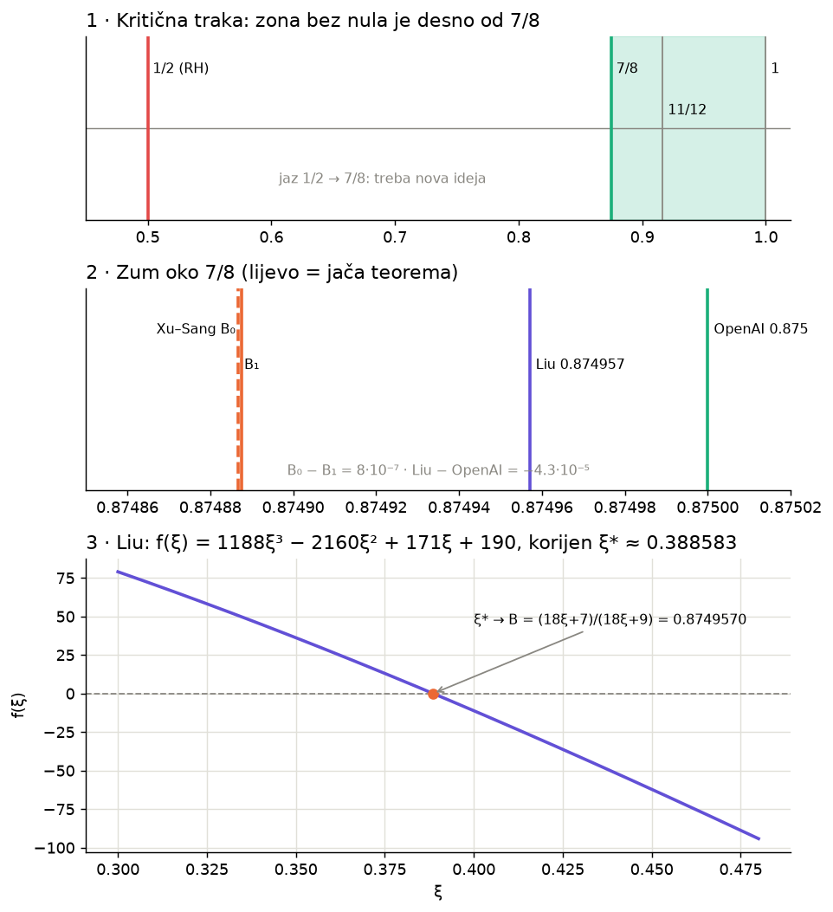
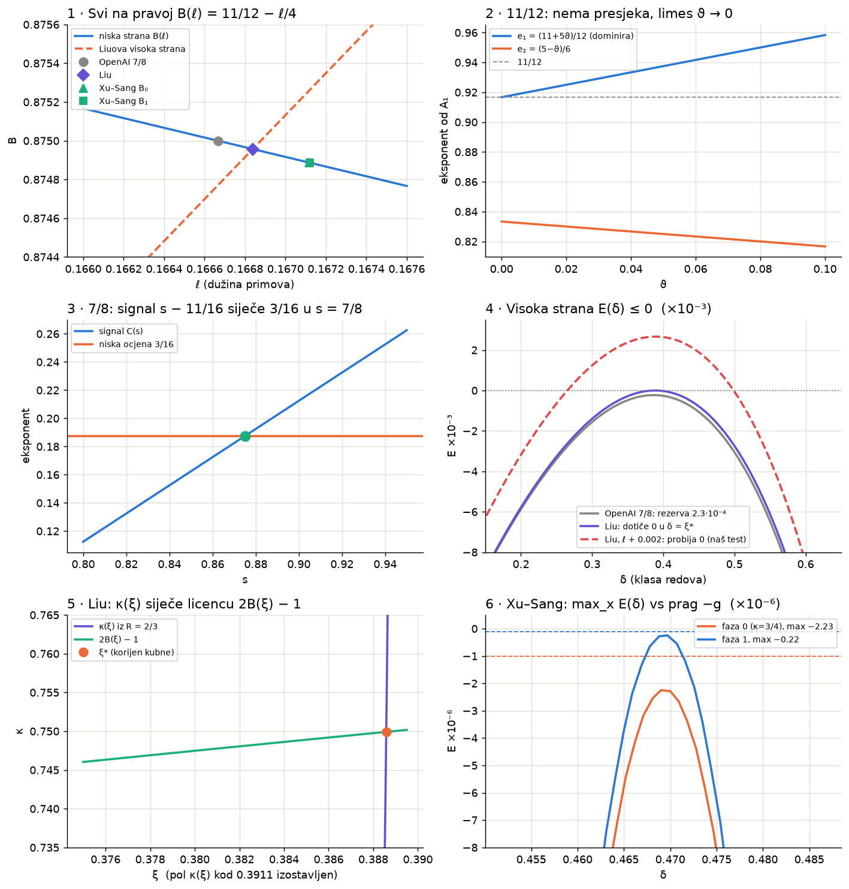
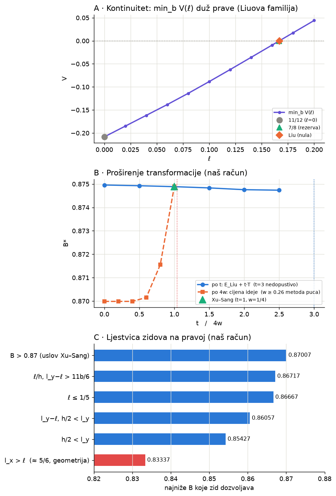

# Kvazi-Rimanova hipoteza (7/8) — analiza za PSE Riemann

Datum: 2026-10-25. Status: **istraživačka bilješka, ništa nije recenzirano.**
Oznake: **[RAD]** = iz objavljenog rada, provjereno našim računom · **[NAŠE]** = naš račun, nerecenzirano · **[DJELIMIČNO]** = nepotpuno ili naše čitanje.

## 0. Šta se desilo (hronologija)

| Datum | Događaj | Status |
|---|---|---|
| 30. sep 2026 | OpenAI: ζ i sve Dirichletove L-funkcije (i Hecke nad ℚ(√−3)) nemaju nula za Re s > 7/8 (199 str.) | Lean formalizovano, nerecenzirano |
| 1. okt | OpenAI: uniformno isključenje Landau–Siegelovih nula | Lean, nerecenzirano |
| 5. okt | OpenAI: kraći dokaz za 11/12 (49 str., jedini ljudski uređen) | bez Lean-a, eksperti uglavnom vjeruju |
| 8–12. okt | Liu, arXiv 2610.12234: B ≈ 0.874957019420 (korijen kubne) | preprint, Lean |
| 15. okt | Xu–Sang, arXiv 2610.15291: 69991/80000 → 0.8748867 (dvije faze) | preprint, uslovno na OpenAI ulaze |
| 19. okt | Quanta: Radziwiłł — loše napisano ali vjerovatno tačno; Sarnak čeka ljudsku provjeru | |

Odbačeno kao nepouzdano: tech-insider "Claude 67.2%" (nedosljedni datumi, nepotvrđeno).

## 1. Sistemi eksponenata — odakle brojevi [RAD]

Granice ne nastaju presjekom samih L-funkcija, nego presjekom **funkcija eksponenata** iz dokaza (niska strana vs visoka strana).

- **11/12**: |A₁| ≪ D^{(11+5ϑ)/12+ε}, druga grana D^{(5−ϑ)/6}. Nikad se ne sijeku; 11/12 je **limes ϑ→0⁺**.
- **7/8**: signal C(s) = s − 11/16 siječe nisku ocjenu 3/16 tačno u s = 7/8 (σ₀ = 1 − h/6 + b/12, b=1/8, h=13/16, ℓ=1/6). Visoka strana ima **rezervu** −E* = 7/30672 ≈ 2.28·10⁻⁴ (nije iscijeđena).
- **Liu**: tri ravni L₀, L_K, H_ξ sijeku se u jednoj tački; licenca κ = 2B − 1 daje p(ξ)=1188ξ³−2160ξ²+171ξ+190=0, B=(18ξ+7)/(18ξ+9)=0.874957019420.
- **Xu–Sang**: certifikovani racionalni izbori (ne optimum, sami kažu). Stage 0: κ=3/4, b=173/2000, ℓ=10027/60000 → 69991/80000. Stage 1: κ=29991/40000 → 8748867/10⁷.

**Zajednička prava:** svi leže na B(ℓ) = 11/12 − ℓ/4 (ℓ = dužina primova). 11/12 je tačka ℓ=0, 7/8 je ℓ=1/6.

Detalji formula: `AGENT_EXTRACTION.md`. Provjere: `results/check_agent_verification.txt`.

## 2. Funkcija koja daje tačke [RAD + NAŠE]

Za svaku metodu: **V(ℓ) = max_{δ,x} E(δ,x; ℓ,b,κ)** uz κ = 2B − 1. Granica metode = najveći ℓ sa V(ℓ) ≤ 0.

- **Kontinuitet [NAŠE]:** u Liuovoj familiji min_b V(ℓ) je glatka i monotona, od −5/24 (ℓ=0, tj. 11/12) do +0.044 (ℓ=0.2); nulu siječe jednom, kod Liua. Tačka 7/8 je unutar familije sa V = −2.2815·10⁻⁴ (isti broj kao u OpenAI radu). → `results/continuity.txt`
- **Egzaktni polinomi:** naš pipeline eliminacije (sympy, rezultante) **reprodukuje Liuov kubni tačno** (`results/pipeline_liu_validation.txt`). Istim pipeline-om, **[NAŠE]** optimum Xu–Sang sistema:

  **133488B⁴ − 376596B³ + 384534B² − 167541B + 26231 = 0, B = 0.874886647039964**
  (ekvivalentno 927ℓ⁴ − 3135ℓ³ + 2433ℓ² + 275ℓ − 100 = 0, ℓ = 0.1671200785; b = 0.0865350, δ* = 0.4693449, x* = 1/2)

  Objavljeni 0.8748867 je ~5.3·10⁻⁸ iznad onoga što njihov sistem dozvoljava. → `results/xs_quartic.txt`

## 3. Transformacija Liu → Xu–Sang [NAŠE, egzaktno]

**E_XuSang = E_Liu + T**, T = (h/4)(1−R) − ℓδ + c·δ·x·(h/4 − l_y/2), c = 1/(3κ).
Provjereno na 2000 slučajnih tačaka, greška 2·10⁻¹⁶.

Tumačenje (ispravljeno): Xu–Sang **brišu član ℓδ** iz Liuove ocjene (dobitak), a zauzvrat koriste samo **3/4 koristi od brojanja redova** (𝒦 = (3R+1)/4 umjesto R) — to je cijena.

## 4. Proširenje transformacije — bliže ili dalje? [NAŠE]

| Poluga | Šta se dešava | Zaključak |
|---|---|---|
| **t** (E_Liu + t·T, "više iste ideje") | t=0: 0.87495702 (Liu), 0.5: 0.87492636, 1: 0.87488665 (XS), 1.5: 0.87483318, 2: 0.87475723, 2.5: 0.87473555, t=3 nedopustivo (b→0) | približava se, ukupno ≤ 1.5·10⁻⁴; zasićuje |
| **w** (udio izgubljene koristi redova; XS w=1/4) | w=0–0.1: 0.86999 (zid), 0.15: 0.87015, 0.2: 0.87155 (grubi sweep; konvergirano 0.8715502525 — vidi app `test_open_door_data`), 0.25: 0.87489, **w ≥ 0.26: metoda puca** | XS sjede na litici; jeftiniji pojačani moment = najjača poluga (~30× od t) — **hipoteza** |
| **licenca** κ←2B−1 | kontrakcija faktora 0.0012 (Liu), 0.0030 (XS); iscrpljena za ~3 koraka | mrtva poluga |

→ `results/sweep_w_t.txt`, `results/sweep_wall_adjacent.txt`, `results/step2_sensitivities_licence.txt`

Napomena o greškama: prvi sweep je imao bug (mala δ-grana na pogrešnom opsegu, brentq na pogrešnoj grani); ispravljeno, a w=1/4 i t=0,1 reprodukuju poznate tačke.

## 5. Zidovi [NAŠE]

Najniže B koje prava B(ℓ)=11/12−ℓ/4 dozvoljava, kad se uslovi dopustivosti (Xu–Sang §6.2) skidaju jedan po jedan:
0.87007 (B>0.87) → 0.86717 (ℓ/h, l_y−ℓ>11b/6) → 0.86667 (ℓ≤1/5) → 0.86057 → 0.85427 (h/2<l_y) → **0.83337 ≈ 5/6 (l_x>ℓ, strukturni)**.

**Zaključak:** nijedna kontinualna deformacija unutar ove geometrije ne prolazi ispod 5/6; uz uslove iz radova ~0.867–0.870. Prema 3/4 ili 1/2 ova familija ne vodi — treba nova geometrija. → `results/walls_ladder.txt`

## 6. Ograde
- Pretpostavljeni su analitički ulazi OpenAI rada (moment-ocjene, 7/8 kao licenca).
- Uslovi dopustivosti mogu biti artefakti lema, ne prave granice.
- Optimizacija po x na ograničenoj mreži (kritično x = 1/2 svuda gdje smo provjerili).
- Zašto rad o 11/12 traži ϑ ≤ 1/10 — izvor ne kaže. **[DJELIMIČNO]**
- Da OpenAI 7/8 visoka strana "nije iscijeđena" je naše čitanje grafa rezerve. **[DJELIMIČNO]**

## 7. MISIJA (za pse-riemann missions)
> Postoji li **kontinualna** funkcija transformacije koja eksponent visoke strane jedne QRH metode prevodi u sljedeću (Liu → Xu–Sang: E_XS = E_Liu + T, potvrđeno), i da li njeno proširenje (t, w, nove familije) pomjera B prema ciljevima (0.87, 5/6, 3/4, 1/2) ili od njih? Svaki novi rad = nova tačka i nova T.

Djelimičan odgovor (ovaj izvještaj): unutar Liu/Xu–Sang familije — da, kontinualna; proširenja se približavaju do zidova (~0.870 / 5/6), ne prema 1/2.

## 8. Prijedlog za kodiranje pse-riemann (za dogovor, nije počelo)
1. **Istraživač metoda** u SHARED_LIB: metoda = (E, parametri, zidovi, izvor); računa V(ℓ), optimum, egzaktni polinom; poredi metode; predlaže/proširuje T; javlja bliže/dalje/zid.
2. **Lab eksperimenti** (COMPUTED + sha256): `qrh_line`, `qrh_poly`, `qrh_transform`, `qrh_walls`, `qrh_licence`.
3. **Kartice:** 4 izvora; naši rezultati (polinom 4. stepena, litica w, zid 5/6) kao nerecenzirano; misija; barijere.
4. **Nadzornik** = PSE-L generator u SHARED_LIB (master §3, §5): proza o run-ovima samo za registrovanog korisnika, svaka rečenica vezana za ID run-a.

## Sadržaj foldera
- `REPORT.md` — ovo · `AGENT_EXTRACTION.md` — izvlačenje formula iz izvora · `SOURCES.md` — linkovi
- `scripts/` — sve skripte (pokretati iz venv-a sa sympy, numpy, scipy)
- `results/` — izlazi skripti · `figures/` — slike kao PNG (`fig1_overview.png`, `fig2_crossings.png`, `fig3_continuity_walls.png`) i interaktivne verzije fig1–3.html (otvoriti u browseru, trebaju internet za Chart.js)
- `scripts/make_png_figures.py` — ponovo crta sve PNG slike
- `papers-local/` — izvori radova, **samo lokalno** (nije na GitHubu zbog licenci)
